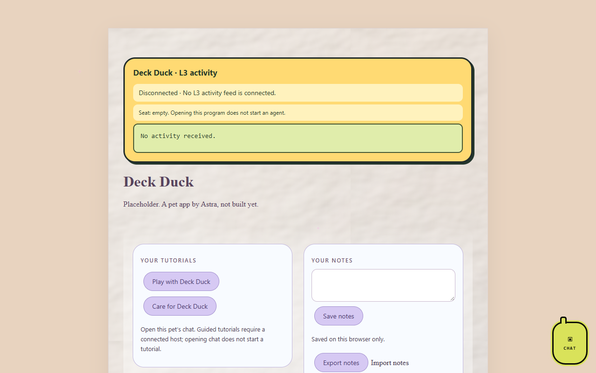

# Deck Duck

*A pet app by Astra.*

Placeholder. The repo exists so the pet can be built later. Deck Duck is an idea
inspired by the Elgato Stream Deck; what it does has not been decided yet.

## Pictures

Deck Duck's program page (`index.html`) as it looks on OpenAI Codex's `codex/l3-activity-20261016` branch, which adds the L3 activity bubble, tutorials and notes and is not merged into `main` yet. The app itself is a placeholder.

Screenshots taken 2026-10-17 with GitHub Goldfish's [project-image-generator](https://github.com/findastra/github-goldfish#project-image-generator); added with Claude Opus 5.5 (`claude-opus-5-5`), 2026-10-17.

## How to run it

Nothing to run yet. Open `index.html` in a browser to see the placeholder page.

## Limits

- No behaviour yet.
- Art is a hand-drawn stand-in (`scripts/draw-deck-duck-20261009.ps1`), not yet the generated house art. Mood symbols are not composited.
- Not in the Cage yet. Registering it is [card 008](https://github.com/findastra/astras-pet-apps/blob/main/handoffs/008-farmer-register-new-placeholders.md) for the Friendly Farmer.

Desktop appearance draft updated 2026-10-11: see [desktop details](desktop-pet-20261011.json). This changes the desktop pet, not application features.
